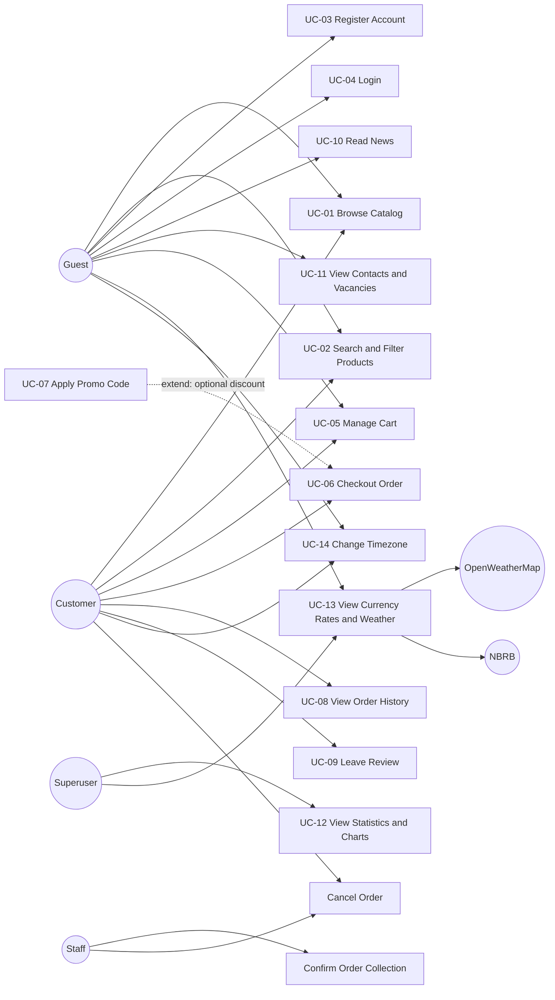

# Software Requirements Specification (SRS)

**Project:** Autosalon Shop
**Version:** 1.1
---

# 1. Introduction

## 1.1 Purpose

This document specifies the business, user, functional, and non-functional
requirements for the **Autosalon Shop** web application.

---

## 1.2 Scope

The system provides an end-to-end e-commerce experience for purchasing
automotive spare parts.

The application supports:

* Product catalog browsing
* Product search and filtering
* Shopping cart management
* Customer registration and authentication
* Order checkout
* Pickup point selection
* Promo codes and discounts
* Personal order history
* Product reviews
* News and informational content
* FAQ and vacancies
* Statistics and charts for superusers
* Currency exchange rates
* Weather information
* Timezone selection
* Django administration
* Docker-based deployment

The system integrates with external services for:

* Weather information — OpenWeatherMap API
* Currency exchange rates — National Bank of the Republic of Belarus (NBRB) API

---

## 1.3 Definitions and Abbreviations

| Term | Definition |
| ------------ | ----------------------------------------------------------------- |
| Customer | Registered user who places orders |
| Employee | Company staff member |
| Sale | An order represented by the `Sale` entity |
| SaleItem | Individual product line within a sale |
| Product | Automotive spare part available for purchase |
| ProductType | Category/type of a product |
| Manufacturer | Company that manufactures a product |
| Supplier | Company supplying products |
| Supply | Record describing supplied products |
| PickupPoint | Physical location where the customer collects an order |
| PromoCode | Discount code applied to an order |
| Review | Customer feedback associated with a user and optionally a product |
| NBRB | National Bank of the Republic of Belarus |
| SRS | Software Requirements Specification |
| UC | Use Case |
| API | Application Programming Interface |
| ORM | Object-Relational Mapping |
| UI | User Interface |
| CSRF | Cross-Site Request Forgery |

## 1.4 Verification approach

Verification methods are attached to the requirements in sections 2–6:
**UT** — isolated unit test with mocks and no database access;
**IT** — integration test with Django Client/ORM or an HTTP transport stub;
**ST** — scenario with successive operations;
**CR** — source/configuration review;
**MT** — manual runtime check;
**LN** — load measurement.

“Verified” means checked in the local SQLite environment. “Partial” links to
an open defect in [ISSUES.md](ISSUES.md). “Not measured” is not a pass.
The scoped test results and assignment checklist are in [TESTING.md](TESTING.md).
Search wording was rewritten to specify the actual substring behavior; vague
load criteria now specify requests, concurrency and an observable result.

# 2. Business Requirements

## 2.1 Business Problem

Automotive spare-part retail traditionally relies on physical visits and
telephone communication.

Without an online store:

* Customers cannot easily browse the available assortment.
* Customers cannot conveniently compare product prices.
* Customers cannot place orders outside business hours.
* Store owners have limited centralized sales analytics.
* Product popularity and customer demographics are harder to analyze.
* Promotional discounts cannot be managed through an automated checkout
  workflow.

The Autosalon Shop application addresses these problems by providing a
centralized online sales platform.

---

## 2.2 Business Goals

| ID | Goal | Success Metric | Method | Verification | Result |
| ----- | ----------------------------------------------------- | ------------------------------------------------------------------------- | --- | --- | --- |
| BG-01 | Provide a 24/7 online channel for selling auto parts | Checkout has no time-of-day restriction while the service is available | CR + ST | Review absence of checkout business-hour gate; lifecycle scenario creates order automatically. | Verified in application; infrastructure uptime not measured |
| BG-02 | Reduce manual workload of sales managers | Order placement is fully automated | ST | test_cart_checkout_pickup_or_cancel_lifecycle: cart → checkout → stored Sale/items without manager action. | Verified |
| BG-03 | Support promotional discounts | Valid promo codes can be applied at checkout | UT + ST | Mock promo calculation; discounted checkout scenario checks persisted totals. | Verified |
| BG-04 | Improve customer interaction through reviews and news | Users can read and submit reviews and access published news | IT + ST | Public content filter; review creation/moderation/edit/delete scenario. | Verified |
| BG-05 | Provide owners with sales analytics | Statistics and charts are available to authorized administrators | IT + MT | Known statistics aggregates and PNG generation; GET media chart URL; browser display. | Partial: ISSUE-004 |
| BG-06 | Support currency and contextual information | Currency rates and Minsk weather are displayed | IT | test_datetime_page_parses_both_external_services_at_http_boundary with NBRB/weather HTTP stubs. | Verified with stubs; live APIs not tested |
| BG-07 | Validate registration and restrict protected operations | Reject under-18/invalid-phone registration; require authentication for checkout | IT | Invalid registration and anonymous checkout checks. | Verified |

---

## 2.3 Business Scope

### In Scope

* Product catalog
* Product search and filtering
* Shopping cart
* Checkout
* Order history
* Promo codes
* Reviews
* News
* FAQ
* Vacancies
* Statistics dashboard
* Currency rates
* Weather widget
* Timezone selection
* Django administration
* Docker-based deployment

---

# 3. User Requirements and Use Cases

## 3.1 Actors

| Actor | Description |
| --------------------- | -------------------------------------------------------------------- |
| Guest | Unauthenticated visitor |
| Customer | Authenticated user with a `Customer` profile |
| Superuser / Admin | Administrator with access to statistics |
| Staff | Authenticated is_staff user who confirms collection and may cancel orders |
| External Weather API | OpenWeatherMap service |
| External Currency API | NBRB service |

---

## 3.2 Use Case Diagram

---

## 3.3 User Requirements

| ID | Requirement | Actor | Priority | Method | Verification | Result |
| ----- | --------------------------------------------------------------------------------------------------------------------------------------------- | ---------------- | -------- | --- | --- | --- |
| UR-01 | A guest shall be able to browse the product catalog with filtering by category, manufacturer, and price range. | Guest | High | IT | Catalog search/price/sort, related-entity filters and pagination tests. | Verified |
| UR-02 | A guest shall be able to register an account by providing username, email, phone, and birth date. The customer must be at least 18 years old. | Guest | High | IT + UT | Register/login/logout scenario, invalid input tests and 18th-birthday boundary. | Verified |
| UR-03 | A customer shall be able to add products to a cart and adjust quantities up to the available stock. | Customer | High | ST + IT | Lifecycle updates quantity; exact stock/overflow/removal and invalid quantity checks. | Verified |
| UR-04 | A customer shall be able to checkout an order by selecting a pickup point and optionally applying a promo code. | Customer | High | ST + IT | Checkout with/without promo; test_checkout_requires_pickup_point. | Partial: ISSUE-001 |
| UR-05 | A customer shall be able to view personal order history with total and discounted amounts. | Customer | High | IT | Owner-only date-sorted history; test_order_history_displays_discounted_total checks HTML. | Partial: ISSUE-002 |

---

## 3.4 Detailed Use Cases

### UC-01 — Browse Catalog

**Actor:** Guest or Customer

**Preconditions:**

* The application is available.
* Products exist in the database.

**Main Flow:**

1. User opens the catalog.
2. System retrieves available products.
3. System excludes products with zero stock.
4. System displays products using pagination.
5. User can navigate between pages.

---

### UC-02 — Search and Filter Products

**Actor:** Guest or Customer

**Main Flow:**

1. User opens the catalog.
2. User enters a search query or selects filters.
3. System filters products by:

   * Product type
   * Manufacturer
   * Price range
   * Product name
   * Product article
4. System optionally sorts the results.
5. Filtered products are displayed.

---

### UC-03 — Register Account

**Actor:** Guest

**Preconditions:**

* User is not authenticated.

**Main Flow:**

1. Guest opens `/register/`.
2. Guest provides:

   * Username
   * Email
   * Phone
   * Birth date
   * Password
   * Password confirmation
3. System validates the submitted data.
4. System validates the phone number.
5. System checks that the customer is at least 18 years old.
6. System creates a Django `User`.
7. System creates the corresponding `Customer`.
8. System redirects the user to the login page.

**Alternative Flows:**

* Invalid phone → validation error.
* User is younger than 18 → validation error.
* Passwords do not match → validation error.
* Username or email is invalid → validation error.

---

### UC-04 — Login

**Actor:** Guest

**Main Flow:**

1. User opens the login page.
2. User enters credentials.
3. Django authenticates the user.
4. User is redirected to the appropriate page.

---

### UC-05 — Manage Cart

**Actor:** Guest or Customer

**Preconditions:**

* None.

**Main Flow:**

1. User opens a product page.
2. User selects a quantity.
3. User adds the product to the cart.
4. System checks the requested quantity against available stock.
5. System stores the cart in `request.session['cart']`.
6. User can update item quantities.
7. User can remove items.

**Alternative Flow:**

* Requested quantity exceeds stock → error message and no cart update.

---

### UC-06 — Checkout Order

**Actor:** Customer

**Preconditions:**

* User is authenticated.
* A `Customer` profile exists.
* The cart is not empty.
* A pickup point is selected.

**Main Flow:**

1. Customer opens `/checkout/`.
2. Customer selects a pickup point.
3. Customer optionally selects a promo code.
4. Customer submits the checkout form.
5. System validates the customer and cart.
6. System creates a `Sale`.
7. System creates related `SaleItem` records.
8. System recalculates the order total.
9. System applies a valid promo code if present.
10. System updates product stock.
11. Transaction is committed.
12. Cart is cleared.
13. Success message and order information are displayed.

**Alternative Flows:**

* Inactive/expired promo code → order is created without the discount.
* Nonexistent promo ID → checkout fails and the transaction is rolled back.
* Insufficient stock → transaction is rolled back and an error is shown.
* Database error → transaction is rolled back.
* Missing pickup point → checkout validation fails.

---

### UC-07 — Apply Promo Code

**Actor:** Customer

**Preconditions:**

* A promo code is available.

**Main Flow:**

1. Customer selects a promo code.
2. System checks:

   * `is_active`
   * `valid_from`
   * `valid_to`
3. System associates the promo code with the `Sale`.
4. System calculates `discounted_total_amount`.

**Alternative Flow:**

* Promo code is invalid or expired → discount is not applied and a warning
  is displayed.

---

### UC-08 — View Order History

**Actor:** Customer

**Main Flow:**

1. Customer opens `/profile/orders/`.
2. System retrieves orders belonging to the current customer.
3. Orders are sorted by date descending.
4. System displays:

   * Order information
   * Total amount
   * Discount
   * Discounted total

---

### UC-09 — Leave Review

**Actor:** Customer

**Main Flow:**

1. Customer opens the review form.
2. Customer enters review information.
3. Customer selects a rating from 1 to 5.
4. System validates the rating.
5. System stores the review.

---

### UC-10 — Read News

**Actor:** Guest or Customer

**Main Flow:**

1. User opens the news section.
2. System retrieves published articles.
3. System displays the articles.

Unpublished articles must not be visible in public views.

---

# 4. Functional Requirements

| ID | Requirement | Related UR | Priority | Method | Verification | Result |
| ----- | --------------------------------------------------------------------------------------------------------- | ---------- | -------- | --- | --- | --- |
| FR-01 | The system shall display a product catalog with pagination of 12 items per page. | UR-01 | High | IT | test_catalog_pagination_and_related_products: 13 products give pages of 12 and 1. | Verified |
| FR-02 | The system shall filter products by `ProductType`. | UR-01 | High | IT | test_catalog_filters_by_related_entity[category-product_type_id]. | Verified |
| FR-03 | The system shall filter products by manufacturer. | UR-01 | High | IT | test_catalog_filters_by_related_entity[manufacturer-manufacturer_id]. | Verified |
| FR-04 | The system shall filter products by minimum and maximum price. | UR-01 | High | IT | Catalog cases price_min=200 and price_max=100 verify inclusive bounds. | Verified |
| FR-05 | The system shall support case-insensitive substring search by product name and article. | UR-01 | High | IT | Catalog query alp matches Alpha; CAT-B matches article. | Verified |
| FR-06 | The system shall exclude products where `stock <= 0` from the public catalog. | UR-01 | High | IT | Catalog fixture includes stock=0; default listing excludes it. | Verified |
| FR-07 | The system shall validate phone numbers against `+375 (XX) XXX-XX-XX`. | UR-02 | High | IT + UT | Invalid registration phone and parameterized phone validator. | Verified |
| FR-08 | The system shall reject registration for users younger than 18. | UR-02 | High | IT + UT | Under-18 registration; exactly 18 passes and one day younger fails. | Verified |
| FR-09 | The system shall create a `Customer` profile linked to the Django `User` after successful registration. | UR-02 | High | IT | test_register_login_and_logout_persist_linked_profile asserts User/Customer relation. | Verified |
| FR-10 | The system shall add products to a session-based cart with a selected quantity. | UR-03 | High | ST | Lifecycle scenario checks selected quantities in session after requests. | Verified |
| FR-11 | The system shall prevent adding a quantity greater than available stock. | UR-03 | High | IT | Exact-stock boundary and overflow keep prior cart quantity. | Verified |
| FR-12 | The system shall require authentication before checkout using `LoginRequiredMixin`. | UR-04 | High | IT | test_anonymous_cannot_access_protected_page[checkout]. | Verified |
| FR-13 | The system shall create `Sale` and related `SaleItem` records within a single database transaction. | UR-04 | High | ST | Failure on second position rolls back Sale/items/stock; retry succeeds. | Verified |
| FR-14 | The system shall apply valid promo codes to calculate `discounted_total_amount`. | UR-04 | High | ST + UT | Discounted lifecycle checks total 200 → 180; unit discount test uses mocked promo. | Verified |
| FR-15 | The system shall validate promo codes using active status and date range. | UR-04 | High | UT + IT | Promo active/date-boundary cases and expired checkout without discount. | Verified |
| FR-16 | The system shall clear the cart after successful checkout. | UR-04 | High | ST | Successful lifecycle scenario checks empty session cart. | Verified |
| FR-27 | The system shall display customer order history sorted by date descending. | UR-05 | High | IT | test_order_history_is_newest_first_and_excludes_other_customers. | Verified |

---

# 5. Non-Functional Requirements

| ID | Category | Requirement | Target | Method | Verification | Result |
| ------ | -------------------- | -------------------------------------------------------------------------------------------------------------------- | --------------------------------- | --- | --- | --- |
| NFR-01 | Performance | Catalog response time for 200 requests after warm-up, 10 concurrent clients, on a documented host | < 2 seconds p95 | LN | Warm up catalog; send 200 requests with 10 concurrent clients; record host, p95 and HTTP errors. | Not measured |
| NFR-02 | Scalability | Complete 100 simultaneous authenticated catalog/cart sessions without HTTP 5xx on production PostgreSQL; SQLite is the development database | ≥ 100 concurrent sessions | CR + LN | Inspect active DB engine; run 100 concurrent authenticated sessions against PostgreSQL and count 5xx. | Not verified; active SQLite: ISSUE-003 |
| NFR-03 | Security | Passwords shall use Django's default password hashing mechanism and CSRF protection shall be enabled for POST forms. | Django defaults | CR + IT | Review Django password/CSRF settings; password hash check after registration; POST without CSRF token gets 403. | Verified locally |
| NFR-04 | Security | Access to statistics shall be restricted to superusers. | 100% enforcement | IT | Statistics: anonymous redirected, regular user 403, superuser receives aggregates. | Verified |
| NFR-05 | Maintainability | Code shall be organized into Django applications with clear module responsibilities. | Code review | CR | Compare apps, responsibilities, routes and imports with README architecture/module table. | Verified by source review |
| NFR-06 | Portability | Application shall be deployable using Docker on Linux and Windows hosts. | Successful Docker build | CR + MT | Build image and run with env file on Linux/Windows; verify migrations, catalog and static/media responses. | Build/runtime not tested; static collection defect: ISSUE-005 |

---

# 6. State Diagram — Sale Lifecycle

The most lifecycle-rich business entity is `Sale`, which represents an
order.

## 6.1 State Diagram

```mermaid
stateDiagram-v2
    [*] --> Draft : Customer adds items to cart

    Draft --> Pending : Customer submits checkout form
    Draft --> Abandoned : Session ends / cart cleared manually

    Pending --> Confirmed : Sale and items created inside transaction
    Pending --> Failed : Stock insufficient / DB error

    Confirmed --> Discounted : Valid promo code applied
    Confirmed --> AwaitingPickup : No valid promo code; commit checkout

    Discounted --> AwaitingPickup : discounted total computed; commit checkout

    AwaitingPickup --> Completed : Staff confirms collection via POST
    AwaitingPickup --> Cancelled : Owner or staff cancels via POST

    Completed --> [*]
    Cancelled --> [*]
    Failed --> [*]
    Abandoned --> [*]
```

---

## 6.2 States

| State | Description | Persistence | Verification |
| -------------- | ---------------------------------------------------------------------------------- | --------------------------------- | --- |
| Draft | Cart exists in the session; no `Sale` record has been created. | `request.session['cart']` | ST: cart session exists; Sale absent. |
| Pending | Checkout request has been received and transaction processing has started. | In-memory | ST/CR: checkout starts transaction; successful and failing branches. |
| Confirmed | Sale and items have been created inside checkout; transaction not yet committed. | `Sale.status` inside transaction | ST/IT: persisted intermediate status in model transition test; checkout source review. |
| Discounted | Valid promo applied and total calculated inside checkout. | `Sale.status` inside transaction | IT: test_confirmed_to_pickup_model_transitions checks discounted status and promo. |
| AwaitingPickup | Order is ready for collection at a pickup point. | Database (`status=awaiting_pickup`) | ST: status after checkout commit. |
| Completed | Customer has collected the order. | Database (`Sale.status`) | ST: staff POST collection; status and repeated-transition rejection. |
| Cancelled | Order has been cancelled. | Database (`Sale.status`) | ST: owner POST cancellation; restored stock and repeated-transition rejection. |
| Failed | Checkout failed and transaction was rolled back. | Not persisted | ST: checkout rollback leaves no Sale/items and preserves cart. |
| Abandoned | Cart was cleared or the session ended without checkout. | Not persisted | ST: removing final cart item creates no Sale. |

---

## 6.3 State Transitions

| ID | From | To | Event / Condition | Action | Verification |
| --- | -------------- | -------------- | ------------------------------- | ------------------------------------ | --- |
| T1 | Start | Draft | User adds first product | Update `request.session['cart']` | ST: lifecycle adds items, checks session and absent Sale. |
| T2 | Draft | Pending | Valid checkout request | Validate customer and cart | ST/CR: lifecycle submits checkout; atomic block starts. |
| T3 | Draft | Abandoned | Session ends or cart is cleared | Discard cart | ST: test_clear_cart_abandons_draft_without_creating_sale; session expiry behavior reviewed. |
| T4 | Pending | Confirmed | Sale and items created inside transaction | Create records; final commit occurs after T7/T8 | IT/CR: confirmed model status; lifecycle persists Sale/items in atomic block. |
| T5 | Pending | Failed | Stock or database error | Roll back transaction | ST: stock and database failures roll back first item too. |
| T6 | Confirmed | Discounted | Promo valid; item totals recalculated | Persist discounted status | IT/ST: discounted model status and discounted checkout totals. |
| T7 | Confirmed | AwaitingPickup | No valid promo code | Set awaiting_pickup; commit checkout | IT/ST: no-promo confirmed → awaiting_pickup. |
| T8 | Discounted | AwaitingPickup | Discount calculation completed | Set awaiting_pickup; commit checkout | IT/ST: discounted → awaiting_pickup; checkout commit. |
| T9 | AwaitingPickup | Completed | Staff confirms collection via POST | Complete order | ST: completed lifecycle via staff POST. |
| T10 | AwaitingPickup | Cancelled | Owner or staff cancellation via POST | Cancel order and restore stock | ST: cancelled lifecycle via owner POST and stock restoration. |
| T11 | Completed | End | Terminal state | — | ST: second complete request rejected with 400. |
| T12 | Cancelled | End | Terminal state | — | ST: second cancel request rejected with 400. |
| T13 | Failed | End | Terminal state | — | ST: rollback leaves no order; corrected retry succeeds. |
| T14 | Abandoned | End | Terminal state | — | ST: abandoned draft creates no database order. |

---

## 6.4 State Model Implementation

`Sale.status` persists `Confirmed`, `Discounted`, `AwaitingPickup`, `Completed`,
and `Cancelled`. Checkout advances through the intermediate states inside one
transaction, so only `AwaitingPickup` is visible after a successful commit.
`Draft` lives in the session, `Pending` exists while the transaction runs,
and `Failed` / `Abandoned` do not create persistent orders.

Staff confirm collection using POST `/orders/<id>/complete/`; the customer
owning the order or staff cancel it using POST `/orders/<id>/cancel/`.
Both operations are also available as staff actions in the sales admin list.
Cancellation restores stock while retaining the order and its items for history.
Cancelled orders are excluded from sales amounts and product sales statistics.
Terminal states cannot transition again. Existing orders receive the
`awaiting_pickup` status through migration `0011_sale_status`.

Automated verification: `core/tests/test_order_scenarios.py`; requirement
traceability and execution results: `TESTING.md`.

---

Open discrepancies: [ISSUES.md](ISSUES.md). Specifying a verification method
does not imply every requirement is implemented or every measurement has passed.
