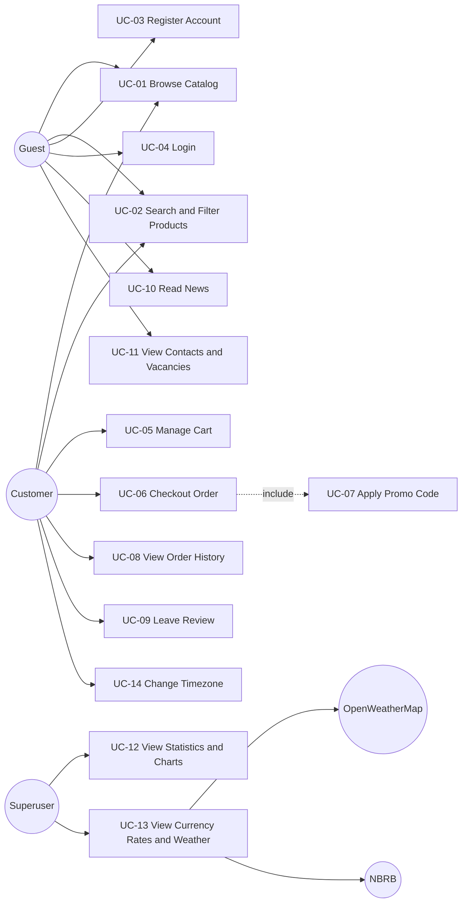
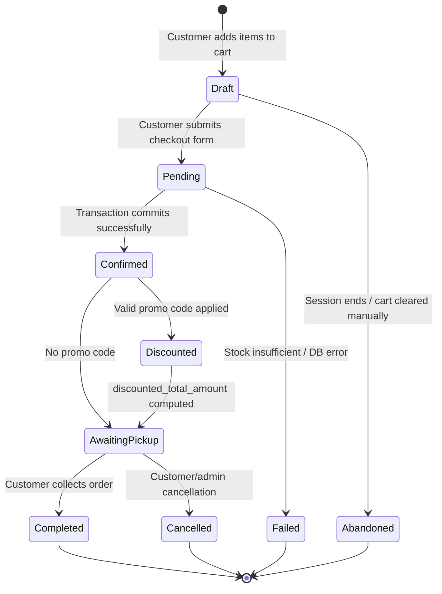

# Software Requirements Specification (SRS)

**Project:** Autosalon Shop
**Version:** 1.0
**Date:** 2026-10-03
---

# 1. Introduction

## 1.1 Purpose

This document specifies the business, user, functional, and non-functional
requirements for the **Autosalon Shop** web application.

---

## 1.2 Scope

The system provides an end-to-end e-commerce experience for purchasing
automotive spare parts.

The application supports:

* Product catalog browsing
* Product search and filtering
* Shopping cart management
* Customer registration and authentication
* Order checkout
* Pickup point selection
* Promo codes and discounts
* Personal order history
* Product reviews
* News and informational content
* FAQ and vacancies
* Statistics and charts for superusers
* Currency exchange rates
* Weather information
* Timezone selection
* Django administration
* Docker-based deployment

The system integrates with external services for:

* Weather information — OpenWeatherMap API
* Currency exchange rates — National Bank of the Republic of Belarus (NBRB) API

---

## 1.3 Definitions and Abbreviations

| Term         | Definition                                                        |
| ------------ | ----------------------------------------------------------------- |
| Customer     | Registered user who places orders                                 |
| Employee     | Company staff member                                              |
| Sale         | An order represented by the `Sale` entity                         |
| SaleItem     | Individual product line within a sale                             |
| Product      | Automotive spare part available for purchase                      |
| ProductType  | Category/type of a product                                        |
| Manufacturer | Company that manufactures a product                               |
| Supplier     | Company supplying products                                        |
| Supply       | Record describing supplied products                               |
| PickupPoint  | Physical location where the customer collects an order            |
| PromoCode    | Discount code applied to an order                                 |
| Review       | Customer feedback associated with a user and optionally a product |
| NBRB         | National Bank of the Republic of Belarus                          |
| SRS          | Software Requirements Specification                               |
| UC           | Use Case                                                          |
| API          | Application Programming Interface                                 |
| ORM          | Object-Relational Mapping                                         |
| UI           | User Interface                                                    |
| CSRF         | Cross-Site Request Forgery                                        |


# 2. Business Requirements

## 2.1 Business Problem

Automotive spare-part retail traditionally relies on physical visits and
telephone communication.

Without an online store:

* Customers cannot easily browse the available assortment.
* Customers cannot conveniently compare product prices.
* Customers cannot place orders outside business hours.
* Store owners have limited centralized sales analytics.
* Product popularity and customer demographics are harder to analyze.
* Promotional discounts cannot be managed through an automated checkout
  workflow.

The Autosalon Shop application addresses these problems by providing a
centralized online sales platform.

---

## 3.2 Business Goals

| ID    | Goal                                                  | Success Metric                                                            |
| ----- | ----------------------------------------------------- | ------------------------------------------------------------------------- |
| BG-01 | Provide a 24/7 online channel for selling auto parts  | Orders can be placed at any time of day                                   |
| BG-02 | Reduce manual workload of sales managers              | Order placement is fully automated                                        |
| BG-03 | Support promotional discounts                         | Valid promo codes can be applied at checkout                              |
| BG-04 | Improve customer interaction through reviews and news | Users can read and submit reviews and access published news               |
| BG-05 | Provide owners with sales analytics                   | Statistics and charts are available to authorized administrators          |
| BG-06 | Support currency and contextual information           | Currency rates and Minsk weather are displayed                            |
| BG-07 | Support legal and data-validation requirements        | Age, phone, authentication, and privacy-related validation is implemented |

---

## 2.3 Business Scope

### In Scope

* Product catalog
* Product search and filtering
* Shopping cart
* Checkout
* Order history
* Promo codes
* Reviews
* News
* FAQ
* Vacancies
* Statistics dashboard
* Currency rates
* Weather widget
* Timezone selection
* Django administration
* Docker-based deployment

---

# 3. User Requirements and Use Cases

## 3.1 Actors

| Actor                 | Description                                                          |
| --------------------- | -------------------------------------------------------------------- |
| Guest                 | Unauthenticated visitor                                              |
| Customer              | Authenticated user with a `Customer` profile                         |
| Superuser / Admin     | Staff member with administrative privileges and access to statistics |
| External Weather API  | OpenWeatherMap service                                               |
| External Currency API | NBRB service                                                         |

---

## 4.2 Use Case Diagram



---

## 3.3 User Requirements

| ID    | Requirement                                                                                                                                   | Actor            | Priority |
| ----- | --------------------------------------------------------------------------------------------------------------------------------------------- | ---------------- | -------- |
| UR-01 | A guest shall be able to browse the product catalog with filtering by category, manufacturer, and price range.                                | Guest            | High     |
| UR-02 | A guest shall be able to register an account by providing username, email, phone, and birth date. The customer must be at least 18 years old. | Guest            | High     |
| UR-03 | A customer shall be able to add products to a cart and adjust quantities up to the available stock.                                           | Customer         | High     |
| UR-04 | A customer shall be able to checkout an order by selecting a pickup point and optionally applying a promo code.                               | Customer         | High     |
| UR-05 | A customer shall be able to view personal order history with total and discounted amounts.                                                    | Customer         | High     |
| UR-06 | A customer shall be able to leave a review with a rating from 1 to 5.                                                                         | Customer         | Medium   |
| UR-07 | A superuser shall be able to view sales statistics, including mean, median, mode, and product popularity charts.                              | Superuser        | Medium   |
| UR-08 | Any user shall be able to view current currency rates for USD, EUR, RUB, and PLN and Minsk weather.                                           | Guest / Customer | Low      |
| UR-09 | Any user shall be able to change the displayed timezone for date/time widgets.                                                                | Guest / Customer | Low      |

---

## 4.4 Detailed Use Cases

### UC-01 — Browse Catalog

**Actor:** Guest or Customer

**Preconditions:**

* The application is available.
* Products exist in the database.

**Main Flow:**

1. User opens the catalog.
2. System retrieves available products.
3. System excludes products with zero stock.
4. System displays products using pagination.
5. User can navigate between pages.

---

### UC-02 — Search and Filter Products

**Actor:** Guest or Customer

**Main Flow:**

1. User opens the catalog.
2. User enters a search query or selects filters.
3. System filters products by:

   * Product type
   * Manufacturer
   * Price range
   * Product name
   * Product article
4. System optionally sorts the results.
5. Filtered products are displayed.

---

### UC-03 — Register Account

**Actor:** Guest

**Preconditions:**

* User is not authenticated.

**Main Flow:**

1. Guest opens `/register/`.
2. Guest provides:

   * Username
   * Email
   * Phone
   * Birth date
   * Password
   * Password confirmation
3. System validates the submitted data.
4. System validates the phone number.
5. System checks that the customer is at least 18 years old.
6. System creates a Django `User`.
7. System creates the corresponding `Customer`.
8. System redirects the user to the login page.

**Alternative Flows:**

* Invalid phone → validation error.
* User is younger than 18 → validation error.
* Passwords do not match → validation error.
* Username or email is invalid → validation error.

---

### UC-04 — Login

**Actor:** Guest

**Main Flow:**

1. User opens the login page.
2. User enters credentials.
3. Django authenticates the user.
4. User is redirected to the appropriate page.

---

### UC-05 — Manage Cart

**Actor:** Guest or Customer

**Preconditions:**

* None.

**Main Flow:**

1. User opens a product page.
2. User selects a quantity.
3. User adds the product to the cart.
4. System checks the requested quantity against available stock.
5. System stores the cart in `request.session['cart']`.
6. User can update item quantities.
7. User can remove items.

**Alternative Flow:**

* Requested quantity exceeds stock → error message and no cart update.

---

### UC-06 — Checkout Order

**Actor:** Customer

**Preconditions:**

* User is authenticated.
* A `Customer` profile exists.
* The cart is not empty.
* A pickup point is selected.

**Main Flow:**

1. Customer opens `/checkout/`.
2. Customer selects a pickup point.
3. Customer optionally selects a promo code.
4. Customer submits the checkout form.
5. System validates the customer and cart.
6. System creates a `Sale`.
7. System creates related `SaleItem` records.
8. System recalculates the order total.
9. System applies a valid promo code if present.
10. System updates product stock.
11. Transaction is committed.
12. Cart is cleared.
13. Success message and order information are displayed.

**Alternative Flows:**

* Invalid promo code → order is created without the discount.
* Insufficient stock → transaction is rolled back and an error is shown.
* Database error → transaction is rolled back.
* Missing pickup point → checkout validation fails.

---

### UC-07 — Apply Promo Code

**Actor:** Customer

**Preconditions:**

* A promo code is available.

**Main Flow:**

1. Customer selects a promo code.
2. System checks:

   * `is_active`
   * `valid_from`
   * `valid_to`
3. System associates the promo code with the `Sale`.
4. System calculates `discounted_total_amount`.

**Alternative Flow:**

* Promo code is invalid or expired → discount is not applied and a warning
  is displayed.

---

### UC-08 — View Order History

**Actor:** Customer

**Main Flow:**

1. Customer opens `/orders/`.
2. System retrieves orders belonging to the current customer.
3. Orders are sorted by date descending.
4. System displays:

   * Order information
   * Total amount
   * Discount
   * Discounted total

---

### UC-09 — Leave Review

**Actor:** Customer

**Main Flow:**

1. Customer opens the review form.
2. Customer enters review information.
3. Customer selects a rating from 1 to 5.
4. System validates the rating.
5. System stores the review.

---

### UC-10 — Read News

**Actor:** Guest or Customer

**Main Flow:**

1. User opens the news section.
2. System retrieves published articles.
3. System displays the articles.

Unpublished articles must not be visible in public views.

---

### UC-11 — View Contacts and Vacancies

**Actor:** Guest or Customer

**Main Flow:**

1. User opens the relevant informational page.
2. System retrieves published vacancies and contact information.
3. System displays the available information.

---

### UC-12 — View Statistics and Charts

**Actor:** Superuser

**Preconditions:**

* `is_superuser == True`.

**Main Flow:**

1. Admin opens `/statistics/`.
2. System computes sales statistics.
3. System computes:

   * Total sales
   * Mean
   * Median
   * Mode
4. System computes customer age statistics.
5. System generates a popularity chart.
6. Chart is saved to `media/charts/popularity.png`.
7. Template displays the statistics and chart.

**Alternative Flows:**

* No sales → statistics default to zero where applicable.
* Matplotlib error → chart is not displayed, but the page remains available.
* Non-superuser → access is denied.

---

### UC-13 — View Currency Rates and Weather

**Actor:** Guest or Customer

**Preconditions:**

* OpenWeatherMap API key is configured for weather information.

**Main Flow:**

1. User opens `/datetime/`.
2. System requests currency rates from NBRB.
3. System requests weather data from OpenWeatherMap.
4. System displays:

   * USD
   * EUR
   * RUB
   * PLN
   * Minsk weather
5. System displays the information according to the selected timezone.

**Alternative Flows:**

* API timeout/error → external widget is unavailable, but the rest of the page
  remains functional.
* Missing weather API key → weather widget is hidden.
* Currency API failure → currency data is unavailable without breaking page
  rendering.

---

### UC-14 — Change Timezone

**Actor:** Guest or Customer

**Main Flow:**

1. User selects a timezone.
2. System validates the timezone.
3. System stores the timezone in:

```python
request.session['user_timezone']
```

4. Date/time widgets use the selected timezone.

---

# 4. Functional Requirements

| ID    | Requirement                                                                                               | Related UR | Priority |
| ----- | --------------------------------------------------------------------------------------------------------- | ---------- | -------- |
| FR-01 | The system shall display a product catalog with pagination of 12 items per page.                          | UR-01      | High     |
| FR-02 | The system shall filter products by `ProductType`.                                                        | UR-01      | High     |
| FR-03 | The system shall filter products by manufacturer.                                                         | UR-01      | High     |
| FR-04 | The system shall filter products by minimum and maximum price.                                            | UR-01      | High     |
| FR-05 | The system shall support sorting by price ascending/descending, name ascending/descending, and newest.    | UR-01      | Medium   |
| FR-06 | The system shall support full-text search by product name and article.                                    | UR-01      | High     |
| FR-07 | The system shall exclude products where `stock <= 0` from the public catalog.                             | UR-01      | High     |
| FR-08 | The system shall validate phone numbers against `+375 (XX) XXX-XX-XX`.                                    | UR-02      | High     |
| FR-09 | The system shall reject registration for users younger than 18.                                           | UR-02      | High     |
| FR-10 | The system shall create a `Customer` profile linked to the Django `User` after successful registration.   | UR-02      | High     |
| FR-11 | The system shall add products to a session-based cart with a selected quantity.                           | UR-03      | High     |
| FR-12 | The system shall prevent adding a quantity greater than available stock.                                  | UR-03      | High     |
| FR-13 | The system shall allow users to update cart quantities.                                                   | UR-03      | Medium   |
| FR-14 | The system shall allow users to remove items from the cart.                                               | UR-03      | Medium   |
| FR-15 | The system shall require authentication before checkout using `LoginRequiredMixin`.                       | UR-04      | High     |
| FR-16 | The system shall create `Sale` and related `SaleItem` records within a single database transaction.       | UR-04      | High     |
| FR-17 | The system shall apply valid promo codes to calculate `discounted_total_amount`.                          | UR-04      | High     |
| FR-18 | The system shall validate promo codes using active status and date range.                                 | UR-04      | High     |
| FR-19 | The system shall clear the cart after successful checkout.                                                | UR-04      | High     |
| FR-20 | The system shall display customer order history sorted by date descending.                                | UR-05      | High     |
| FR-21 | The system shall calculate and display the discount amount for each order.                                | UR-05      | Medium   |
| FR-22 | The system shall allow customers to edit phone number and birth date in their profile.                    | UR-05      | Medium   |
| FR-23 | The system shall store reviews linked to a user and optionally to a product.                              | UR-06      | Medium   |
| FR-24 | The system shall restrict review ratings to the integer range 1–5.                                        | UR-06      | Medium   |
| FR-25 | The system shall provide superuser-only sales statistics including total, mean, median, and mode.         | UR-07      | Medium   |
| FR-26 | The system shall calculate customer age statistics including mean, median, minimum, and maximum.          | UR-07      | Medium   |
| FR-27 | The system shall generate a bar chart of popular product types and save it to `media/charts/`.            | UR-07      | Medium   |
| FR-28 | The system shall fetch currency rates from NBRB and weather from OpenWeatherMap with a 10-second timeout. | UR-08      | Low      |
| FR-29 | The system shall degrade gracefully and return `None` when external APIs fail.                            | UR-08      | Low      |
| FR-30 | The system shall allow the user to set a timezone stored in `request.session['user_timezone']`.           | UR-09      | Low      |
| FR-31 | The system shall expose application entities through the Django admin panel.                              | —          | Medium   |
| FR-32 | The system shall display FAQ items ordered by `order` and then `-date_added` where applicable.            | —          | Low      |
| FR-33 | The system shall display only published articles and vacancies in public views.                           | —          | Medium   |

---

# 5. Non-Functional Requirements

| ID     | Category             | Requirement                                                                                                          | Target                            |
| ------ | -------------------- | -------------------------------------------------------------------------------------------------------------------- | --------------------------------- |
| NFR-01 | Performance          | Catalog page response time under normal load                                                                         | < 2 seconds p95                   |
| NFR-02 | Scalability          | Support concurrent users with SQLite in development and PostgreSQL in production                                     | ≥ 100 concurrent sessions         |
| NFR-03 | Security             | Passwords shall use Django's default password hashing mechanism and CSRF protection shall be enabled for POST forms. | Django defaults                   |
| NFR-04 | Security             | Access to statistics shall be restricted to superusers.                                                              | 100% enforcement                  |
| NFR-05 | Reliability          | External API failures shall not prevent page rendering.                                                              | Graceful fallback                 |
| NFR-06 | Usability            | UI shall be usable on desktop and tablet displays.                                                                   | Minimum desktop viewport 1280×720 |
| NFR-07 | Maintainability      | Code shall be organized into Django applications with clear module responsibilities.                                 | Code review                       |
| NFR-08 | Portability          | Application shall be deployable using Docker on Linux and Windows hosts.                                             | Successful Docker build           |
| NFR-09 | Internationalization | UI text shall be in Russian; code and comments may use English where applicable.                                     | Code review                       |
| NFR-10 | Data Integrity       | Order creation and stock updates shall use database transactions.                                                    | `transaction.atomic()`            |
| NFR-11 | Observability        | Critical operations shall be logged using Python's `logging` module.                                                 | Log entries present               |
| NFR-12 | Compatibility        | Application shall support Python 3.12+, Django 6.0, and modern evergreen browsers.                                   | Manual verification               |

---

# 6. State Diagram — Sale Lifecycle

The most lifecycle-rich business entity is `Sale`, which represents an
order.

## 6.1 State Diagram



---

## 6.2 States

| State          | Description                                                                        | Persistence                       |
| -------------- | ---------------------------------------------------------------------------------- | --------------------------------- |
| Draft          | Cart exists in the session; no `Sale` record has been created.                     | `request.session['cart']`         |
| Pending        | Checkout request has been received and transaction processing has started.         | In-memory                         |
| Confirmed      | `Sale` and associated `SaleItem` records have been created successfully.           | Database                          |
| Discounted     | A valid promo code has been applied and the discounted amount has been calculated. | Database                          |
| AwaitingPickup | Order is ready for collection at a pickup point.                                   | Derived / intended database state |
| Completed      | Customer has collected the order.                                                  | Intended database state           |
| Cancelled      | Order has been cancelled.                                                          | Intended database state           |
| Failed         | Checkout failed and transaction was rolled back.                                   | Not persisted                     |
| Abandoned      | Cart was cleared or the session ended without checkout.                            | Not persisted                     |

---

## 6.3 State Transitions

| ID  | From           | To             | Event / Condition               | Action                               |
| --- | -------------- | -------------- | ------------------------------- | ------------------------------------ |
| T1  | Start          | Draft          | User adds first product         | Update `request.session['cart']`     |
| T2  | Draft          | Pending        | Valid checkout request          | Validate customer and cart           |
| T3  | Draft          | Abandoned      | Session ends or cart is cleared | Discard cart                         |
| T4  | Pending        | Confirmed      | Transaction commits             | Create `Sale` and `SaleItem` records |
| T5  | Pending        | Failed         | Stock or database error         | Roll back transaction                |
| T6  | Confirmed      | Discounted     | Promo code is valid             | Recalculate discounted total         |
| T7  | Confirmed      | AwaitingPickup | No promo code                   | Mark order as ready for pickup       |
| T8  | Discounted     | AwaitingPickup | Discount calculation completed  | Continue to pickup stage             |
| T9  | AwaitingPickup | Completed      | Customer collects order         | Complete order                       |
| T10 | AwaitingPickup | Cancelled      | Customer/admin cancellation     | Cancel order                         |
| T11 | Completed      | End            | Terminal state                  | —                                    |
| T12 | Cancelled      | End            | Terminal state                  | —                                    |
| T13 | Failed         | End            | Terminal state                  | —                                    |
| T14 | Abandoned      | End            | Terminal state                  | —                                    |

---

## 6.4 State Model Limitation

The current implementation does not persist explicit `Completed`,
`Cancelled`, or `AwaitingPickup` statuses on the `Sale` model.

These states are therefore conceptual or derived rather than represented
by a dedicated database field.

This discrepancy is documented as **ISSUE-001** in the issues section.

---


# 7. Requirements Verification Matrix

## 7.1 Verification Methods

| Method | Meaning                                                      |
| ------ | ------------------------------------------------------------ |
| UT     | Unit test using Django `TestCase` or equivalent              |
| IT     | Integration test involving application, client, and database |
| MT     | Manual test                                                  |
| CR     | Code review or static analysis                               |
| LN     | Load/performance test                                        |
| SEC    | Security test                                                |

---

## 7.2 Business Requirements

| ID    | Verification                                                                                                  | Method |
| ----- | ------------------------------------------------------------------------------------------------------------- | ------ |
| BG-01 | Place an order outside normal business hours and confirm creation of a `Sale` record.                         | MT     |
| BG-02 | Confirm that no manual administrative action is required between checkout submission and `Sale` creation.     | IT     |
| BG-03 | Create a promo code, apply it during checkout, and confirm that `discounted_total_amount < total_amount`.     | IT     |
| BG-04 | Create a review as a logged-in user and confirm that it is stored in the database.                            | IT     |
| BG-05 | Log in as a superuser, open `/statistics/`, and confirm that statistics and the chart are displayed.          | MT     |
| BG-06 | Open `/datetime/` and confirm that currency and weather information can be displayed.                         | MT     |
| BG-07 | Attempt registration with an invalid phone number and an under-18 birth date. Both attempts must be rejected. | UT     |

---

## 7.3 User Requirements

| ID    | Verification                                                                                           | Method |
| ----- | ------------------------------------------------------------------------------------------------------ | ------ |
| UR-01 | Open `/catalog/`, apply filters, and confirm that the resulting queryset matches the selected filters. | IT     |
| UR-02 | Submit valid registration data and confirm that both `User` and `Customer` are created.                | IT     |
| UR-03 | Add a product with `quantity=2`, open the cart, and confirm the quantity.                              | IT     |
| UR-04 | Submit checkout with a valid promo code and confirm that a discounted `Sale` is created.               | IT     |
| UR-05 | Log in and open `/orders/`; verify ordering by `-sale_date`.                                           | IT     |
| UR-06 | Submit a review with rating `5` and verify that rating `6` is rejected.                                | UT     |
| UR-07 | Verify that a superuser can access `/statistics/` and a regular user cannot.                           | SEC    |
| UR-08 | Mock an NBRB response and verify that four currency rates are parsed.                                  | UT     |
| UR-09 | Submit `/set-timezone/` with `Europe/Minsk` and verify the session key.                                | IT     |

---

## 7.4 Functional Requirements

| ID    | Verification                                                                                 | Method |
| ----- | -------------------------------------------------------------------------------------------- | ------ |
| FR-01 | Verify catalog pagination is configured for 12 items per page.                               | CR     |
| FR-02 | Open `/catalog/?category=1` and verify that all results belong to the selected product type. | IT     |
| FR-03 | Open `/catalog/?manufacturer=1` and verify manufacturer filtering.                           | IT     |
| FR-04 | Open `/catalog/?price_min=100&price_max=500` and verify the price range.                     | IT     |
| FR-05 | Open `/catalog/?sort=price_asc` and verify ascending order.                                  | IT     |
| FR-06 | Search for a product by name or article and verify matching results.                         | IT     |
| FR-07 | Create a product with `stock=0` and verify that it is absent from the public catalog.        | IT     |
| FR-08 | Verify that `RegisterForm.clean_phone('123')` raises `ValidationError`.                      | UT     |
| FR-09 | Verify that an under-18 birth date raises `ValidationError`.                                 | UT     |
| FR-10 | Submit valid registration and verify that a `Customer` is linked to the new user.            | IT     |
| FR-11 | Add an item to the cart and verify `session['cart']` contains the requested quantity.        | IT     |
| FR-12 | Attempt to add more items than available stock and verify that the cart is unchanged.        | IT     |
| FR-13 | Update a cart item quantity and verify the new value.                                        | IT     |
| FR-14 | Remove a cart item and verify that its session entry is deleted.                             | IT     |
| FR-15 | Request `/checkout/` anonymously and verify redirection to login.                            | IT     |
| FR-16 | Force an exception during checkout and verify that no `Sale` remains in the database.        | IT     |
| FR-17 | Apply a valid promo code and verify the discounted total.                                    | IT     |
| FR-18 | Test an expired promo code and verify that it is considered invalid.                         | UT     |
| FR-19 | Complete checkout and verify that the session cart is empty.                                 | IT     |
| FR-20 | Create multiple sales and verify descending date order.                                      | IT     |
| FR-21 | Verify `discount == total_amount - discounted_total_amount`.                                 | UT     |
| FR-22 | Update the customer's phone number and verify the database change.                           | IT     |
| FR-23 | Create a review without a product association and verify that it is stored.                  | UT     |
| FR-24 | Verify that the review rating field has minimum and maximum validation of 1 and 5.           | CR     |
| FR-25 | Compare calculated sales aggregates with the statistics view context.                        | IT     |
| FR-26 | Calculate ages of known customers and compare them with the statistics context.              | IT     |
| FR-27 | Run chart generation and verify `media/charts/popularity.png` exists.                        | IT     |
| FR-28 | Mock a requests timeout and verify that the external API function returns `None`.            | UT     |
| FR-29 | Remove the weather API key and verify that `get_weather()` returns `None`.                   | UT     |
| FR-30 | Set a timezone and verify that `/datetime/` uses the selected timezone.                      | IT     |
| FR-31 | Verify that application models are registered in the Django admin site.                      | IT     |
| FR-32 | Create FAQ entries with different order values and verify the required ordering.             | IT     |
| FR-33 | Create unpublished articles/vacancies and verify that they are not visible in public views.  | IT     |

---

## 7.5 Non-Functional Requirements

| ID     | Verification                                                                                            | Method |
| ------ | ------------------------------------------------------------------------------------------------------- | ------ |
| NFR-01 | Load `/catalog/` using a load-testing tool with 100 users and verify p95 response time below 2 seconds. | LN     |
| NFR-02 | Run the production configuration using PostgreSQL and test 100 concurrent sessions.                     | LN     |
| NFR-03 | Inspect CSRF middleware and password hashing configuration.                                             | SEC    |
| NFR-04 | Log in as a regular user and request `/statistics/`; verify access is denied.                           | SEC    |
| NFR-05 | Mock external API failures and verify that `/datetime/` still returns successfully.                     | IT     |
| NFR-06 | Manually test the UI at 1280×720 and a tablet viewport.                                                 | MT     |
| NFR-07 | Review application structure, responsibilities, and imports.                                            | CR     |
| NFR-08 | Build and run the Docker image on supported hosts.                                                      | MT     |
| NFR-09 | Review templates and source code for language consistency.                                              | CR     |
| NFR-10 | Review checkout and stock-update code for transaction handling.                                         | CR     |
| NFR-11 | Perform authentication, cart, and checkout operations and inspect log output.                           | MT     |
| NFR-12 | Verify Python/Django versions and test the application in supported browsers.                           | MT     |

---

## 7.6 Rewritten Requirements

The following requirements use measurable criteria because the original
wording was too vague to verify objectively.

| Original Requirement                | Problem                        | Rewritten Requirement                                                                                                              |
| ----------------------------------- | ------------------------------ | ---------------------------------------------------------------------------------------------------------------------------------- |
| "The site should be fast."          | No measurable target.          | Catalog response time shall be below 2 seconds at p95 under the defined test load.                                                 |
| "The site should be secure."        | Too broad to test.             | Passwords shall use Django's supported password hashing mechanism and CSRF protection shall be enabled for POST forms.             |
| "The site should be user-friendly." | Subjective.                    | The UI shall be usable at a 1280×720 desktop viewport and a supported tablet viewport.                                             |
| "External APIs should work."        | No failure behavior specified. | External API calls shall use a defined timeout and return a safe fallback when unavailable.                                        |
| "Statistics should be accurate."    | No calculation definition.     | Sales and customer statistics shall use explicitly defined mean, median, mode, minimum, and maximum calculations where applicable. |

---


