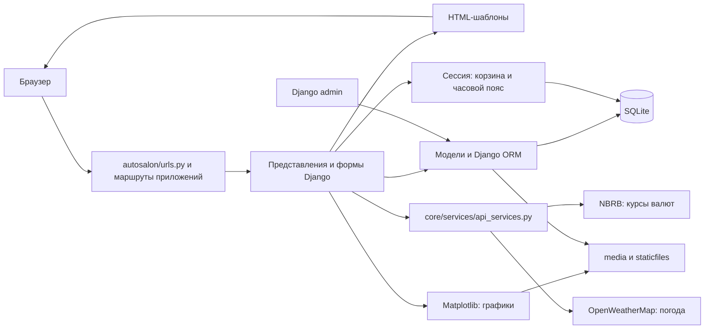

# Autosalon Shop

Интернет-магазин автомобильных запчастей. Покупатели находят товары, управляют
корзиной, оформляют заказ с самовывозом и просматривают историю. Магазин получает
учёт поставок, остатков и продаж, промокоды, отзывы и статистику.

Целевые пользователи: посетители каталога, зарегистрированные покупатели,
сотрудники, выдающие заказы, и администраторы магазина. Статистика доступна
суперпользователям; выдачу заказа подтверждает сотрудник.

## Стек

| Компонент | Используется |
|---|---|
| Язык | Python 3.12, HTML/CSS |
| Фреймворк | Django 6.0, шаблоны Django |
| СУБД | SQLite — текущая активная конфигурация |
| Развёртывание | Gunicorn, Docker, Docker Compose |
| Дополнительные библиотеки | requests, Matplotlib, pytz, python-dateutil, Pillow |
| Тестирование | pytest, pytest-django, pytest-cov |

Точные версии зависимостей указаны в `requirements.txt`. В Compose есть контейнер
PostgreSQL 15, но приложение пока не подключается к нему: [ISSUE-003](ISSUES.md#issue-003).

## Архитектура

Django MVT: URL-маршруты вызывают представления, представления работают с моделями
через ORM и формируют HTML из шаблонов. Корзина и часовой пояс хранятся в сессии.



Связи данных: `User → Customer → Sale → SaleItem → Product`;
`Product → ProductType/Manufacturer`; `Supply → Product/Supplier`;
`Sale → PromoCode/PickupPoint`; `Review → User/Product`.

## Модули и ответственность

| Модуль | Ответственность |
|---|---|
| `autosalon` | Настройки, корневые URL, ASGI/WSGI |
| `core/views/home.py`, `contacts.py` | Главная, информация о компании, контакты, политика конфиденциальности |
| `core/views/catalog.py` | Каталог, поиск, фильтры, сортировка, карточка товара |
| `core/views/cart.py` | Добавление, изменение и удаление позиций корзины |
| `core/views/checkout.py`, `orders.py` | Атомарное оформление, применение скидки, выдача и отмена заказа |
| `core/views/auth.py`, `profile.py` | Регистрация, вход/выход, профиль и история заказов |
| `core/views/calendar.py`, `statistics.py` | Часовые пояса, внешние данные, статистика и графики |
| `core/models.py` | Компания, сотрудники, точки самовывоза |
| `core/services/api_services.py` | HTTP-запросы NBRB и OpenWeatherMap, безопасный результат при ошибке |
| `products/models/products.py`, `categories.py`, `manufacturers.py` | Товары, типы, производители и расчёт остатков |
| `products/models/suppliers.py`, `supplies.py` | Поставщики и поставки |
| `products/models/customers.py`, `validator.py` | Профиль покупателя, проверка телефона и возраста |
| `products/models/sales.py` | Заказ, позиции, суммы, статусы и допустимые переходы |
| `products/middleware.py`, `templatetags/datetime_tags.py` | Часовой пояс запроса и форматирование дат |
| `news`, `faq`, `vacancies` | Новости, вопросы-ответы и вакансии с фильтрацией публикации/активности |
| `promo` | Промокоды, даты действия и список акций |
| `reviews` | Отзывы, модерация, создание/редактирование/удаление владельцем |
| `*/admin.py` | Регистрация моделей и административные операции |

## Точки интеграции

| Точка | Назначение и настройки |
|---|---|
| SQLite | Django ORM; `db.sqlite3`; миграции; транзакции оформления и обновления остатков |
| Django auth и sessions | Учётные записи, права, связанный Customer; корзина и timezone в сессии |
| NBRB HTTP API | USD/EUR/RUB/PLN; тайм-аут 10 секунд; при ошибке возвращается `None` |
| OpenWeatherMap HTTP API | Погода Минска; `OPENWEATHER_API_KEY`; тайм-аут 10 секунд; при ошибке/отсутствии ключа `None` |
| Файловая система | `media/company`, `media/employees`, `media/news`; график `media/charts/popularity.png`; статические файлы `staticfiles` |
| Журнал | `logs/django.log`, ротация, настройка `LOG_LEVEL` |

При `DEBUG=False` Django сам не раздаёт media. Для показа изображений/графиков
нужна раздача файлов веб-сервером; текущий пробел описан в [ISSUE-004](ISSUES.md#issue-004).

## Установка и запуск

Из корня репозитория, где находится `manage.py`:

```bash
python3.12 -m venv autosalon_venv
source autosalon_venv/bin/activate
pip install -r requirements.txt
cp .env.example .env
python -c "import secrets; print(secrets.token_urlsafe(50))"
```

В `.env` замените `SECRET_KEY` выведенным значением и задайте
`ALLOWED_HOSTS=localhost,127.0.0.1`. `OPENWEATHER_API_KEY` необязателен.
`DATABASE_URL` и `DEBUG` сейчас не изменяют активные настройки БД/DEBUG:
они заданы непосредственно в `autosalon/settings.py`.
В Windows окружение активируется командой `autosalon_venv\Scripts\activate`.

```bash
python manage.py migrate
python manage.py createsuperuser
python manage.py collectstatic --noinput
python manage.py runserver --insecure
```

Приложение: [localhost:8000](http://localhost:8000/), admin:
[localhost:8000/admin](http://localhost:8000/admin/).
`--insecure` позволяет раздавать static при текущем `DEBUG=False` только для
локальной разработки. Media по-прежнему требуют отдельной раздачи.

Сборка и запуск контейнера:

```bash
docker build -t autosalon .
docker run --env-file .env -p 8000:8000 autosalon
```

Контейнер запускает миграции и Gunicorn. Сборка/запуск на Linux и Windows в этой
проверке не выполнялись. Есть открытый дефект сборки static:
[ISSUE-005](ISSUES.md#issue-005). SQLite внутри контейнера не сохраняется после его
удаления без отдельного тома. Compose запускается `docker compose up --build`,
но его PostgreSQL пока не используется приложением.

## Требования и тестирование

[DOCS.md](DOCS.md) содержит спецификацию, use case и state-диаграммы и методы
проверки в таблицах требований. [ISSUES.md](ISSUES.md) фиксирует расхождения с
реализацией. [TESTING.md](TESTING.md) содержит результаты и проверку заданий.

```bash
python -m pytest
python -m pytest --shuffle-seed=20261011 --no-cov
```

Первый запуск измеряет покрытие: минимум 70%, HTML — `htmlcov/index.html`,
XML — `coverage.xml`. Второй проверяет независимость от порядка.
Ожидаемые нарушения требований помечены `xfail(strict=True)` и привязаны к
открытым дефектам: они не считаются выполненными требованиями.
